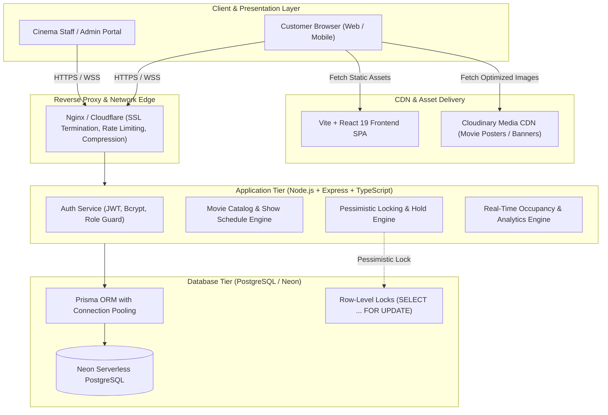
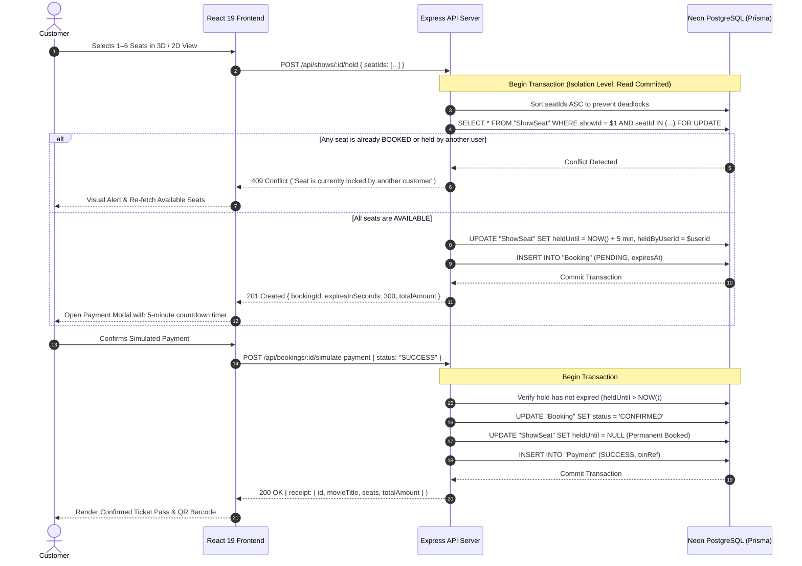
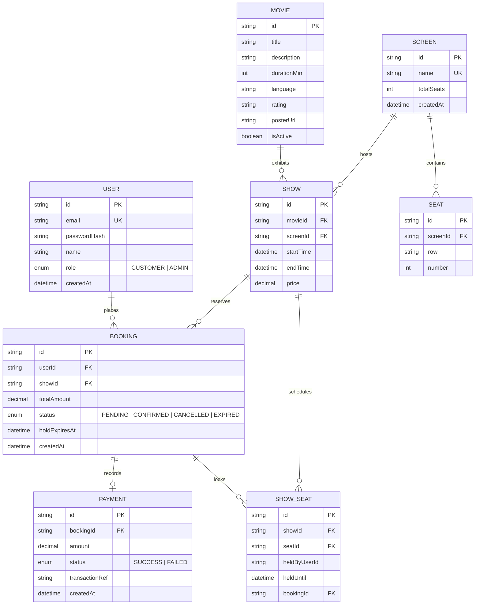

# 🎬 Yozigo — High-Level Design (HLD) & System Architecture Specification

> **Submission for Full-Stack Engineering Intern Selection — Yozigo**  
> **Author:** Amresh Kumar  
> **Date:** October 2026  
> **System:** Distributed, High-Concurrency Cinema Booking & 3D Interactive Simulator

---


## 1. Executive Summary

**Yozigo** is an enterprise-grade movie ticketing platform built for extreme concurrency, zero double-booking tolerance, and visual excellence. In addition to full transactional seat reservation workflows, Yozigo introduces a **realistic 3D cinema auditorium simulator** powered by Three.js and React Three Fiber that lets moviegoers preview the movie screen directly from seated eye-level before purchasing.

The backend is built with **Node.js, Express, and TypeScript**, backed by **Neon PostgreSQL** via **Prisma ORM**, strictly adhering to **ACID transactional semantics**, deterministic row locking, and Zod runtime schema validation.

---

## 2. High-Level Architecture (HLD)

### 2.1 Complete Component Topology



---

## 3. Core Functional & Non-Functional Requirements

### 3.1 Functional Workflows
1. **User Authentication**: Secure registration and login using salted Bcrypt hashes and stateless JWT Bearer authorization.
2. **Movie & Show Exploration**: Real-time browsing of active movie titles, showtimes, genres, and pricing.
3. **Interactive 3D Seating Simulator**:
   - 80 physical auditorium seats across Rows A through H with tiered stadium risers.
   - 2D grid toggle and instant 3D camera zoom to seated eye perspective (`[x, eyeY, z]`).
   - Dynamic cinema screen with high-resolution projection video and active audio-visual atmosphere.
4. **Atomic 5-Minute Seat Hold**:
   - Concurrently lock 1 to 6 seats using transactional pessimistic row locks (`SELECT ... FOR UPDATE`).
   - Automatic 5-minute time-to-live (TTL).
5. **Payment Simulation & Idempotency**:
   - `SUCCESS`: Confirms booking and generates unique ticket pass.
   - `FAILED`: Preserves hold countdown so customer can retry payment without losing seats.
6. **Cancellation Engine (Flow 8)**:
   - Self-service cancellation allowed up to 2 hours before showtime.
   - Rejection with explicit error if within 2 hours or if show has passed.
   - Immediate seat replenishment back to inventory upon cancellation.
7. **Admin Roster & Occupancy (Flow 9)**:
   - Live revenue, total seats, booked seats, and occupancy percentages per show.
   - Detailed customer bookings roster (Booking ID, Customer Name, Email, Seats, Amount, Booked Timestamp).
   - CRUD management for shows (with overlap detection and 15-minute cleaning buffers) and movies.
8. **Live Seat Updates (Flow 10)**:
   - Automatic 3-second seat state polling without page reloads.

### 3.2 Non-Functional Architecture Guarantees
- **Strict Atomicity (Zero Double-Booking)**: Two users clicking the same seat simultaneously will NEVER result in a double-hold.
- **Deadlock Immunity**: All seat IDs are deterministically sorted (`seatIds.sort()`) before obtaining database locks.
- **Data Isolation**: Multi-tenant customer isolation where users can only inspect their own receipts.

---

## 4. End-to-End Booking Lifecycle



---

## 5. Concurrency & Deadlock Prevention Strategy

### 5.1 The Concurrency Problem
In high-demand ticket sales, thousands of users attempt to hold the same prime center seats (e.g., Row D, Seats 5–6) within the same millisecond. Optimistic locking fails frequently under high contention, forcing repeated retries that degrade user experience.

### 5.2 The Yozigo Pessimistic Locking Solution
Yozigo utilizes PostgreSQL pessimistic row-level locking via **`SELECT ... FOR UPDATE`** inside a Prisma transactional block:

```typescript
// 1. Deterministic sort prevents cross-dependency deadlocks
const sortedSeatIds = [...seatIds].sort();

await prisma.$transaction(async (tx) => {
  // 2. Lock specific seat rows for this show in deterministic order
  const lockedShowSeats = await tx.$queryRaw`
    SELECT * FROM "ShowSeat"
    WHERE "showId" = ${showId} AND "seatId" IN (${Prisma.join(sortedSeatIds)})
    FOR UPDATE
  `;

  // 3. Validate seat availability within the protected critical section
  for (const seat of lockedShowSeats) {
    if (seat.bookingId || (seat.heldUntil && seat.heldUntil > new Date())) {
      throw new ApiError(409, 'One or more selected seats are no longer available', [], 'SEATS_UNAVAILABLE');
    }
  }

  // 4. Atomically apply hold
  // ...
}, { timeout: 10000 });
```

### 5.3 Deadlock Prevention Proof
When User A requests seats `[Seat-5, Seat-6]` and User B requests `[Seat-6, Seat-5]`:
- Without sorting: User A locks 5 and waits for 6; User B locks 6 and waits for 5 $\rightarrow$ **Deadlock cycle**.
- With Yozigo deterministic sorting: Both transactions lock Seat-5 first. One succeeds immediately; the second waits cleanly on row 5 and fails cleanly when row 5 updates, with zero deadlocks.

---

## 6. Real-Time Seat Synchronization Strategy (Flow 10)

### Comparison: Polling vs. WebSockets vs. SSE

| Dimension | Short Polling (3s) | Server-Sent Events (SSE) | WebSockets |
|---|---|---|---|
| **Complexity** | Low, extremely robust | Medium (requires connection keep-alive) | High (bidirectional, heartbeat, reconnection) |
| **Serverless / Edge Compatibility** | 100% compatible with Neon, Vercel, AWS Lambda | Requires persistent connection handling | Requires dedicated gateway (e.g. AWS API Gateway WSS) |
| **Reverse Proxy / Firewall Safety** | Standard HTTP/1.1 & HTTP/2, zero blocking | Prone to proxy buffering | Blocked by some corporate enterprise firewalls |
| **Suitability for Cinema Holds** | **Ideal**: Seat holds last 300 seconds; 3s polling yields near-instant freshness | Overkill for 80-seat scale | Overkill for predominantly read-heavy seat maps |

**Decision**: Yozigo uses **adaptive 3-second HTTP polling** on `/api/shows/:id/seats`. It provides sub-3-second real-time state synchronization, zero memory leak risk from open sockets, and seamless auto-recovery if the user temporarily loses internet connectivity.

---

## 7. Database Entity Relationship Model (ERD)



---

## 8. Scalability & Production Readiness

### 8.1 Horizontal Scaling
- **Stateless API Tier**: Express server instances store no in-memory session state (JWT auth). Instances scale horizontally behind an AWS ALB or Cloudflare Load Balancer.
- **Connection Pooling**: Prisma Client is configured with connection limits matching Neon PostgreSQL pooling thresholds to prevent database connection exhaustion.
- **CDN Offloading**: All static assets and movie poster banners are cached globally via Cloudinary CDN with immutable cache headers.

### 8.2 Security Architecture
- **JWT & Role-Based Access Control**: Admins and customers are segmented via strict middleware guards (`authenticate`, `requireAdmin`).
- **Input Sanitization**: Every endpoint payload is validated using runtime Zod schemas before hitting business logic.
- **CORS & Rate Limiting**: Strict origin restrictions and Express rate limiters protect against brute-force authentication attacks.
